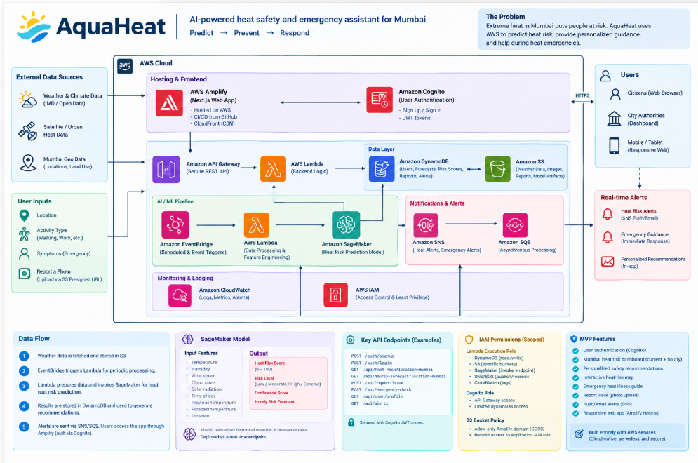
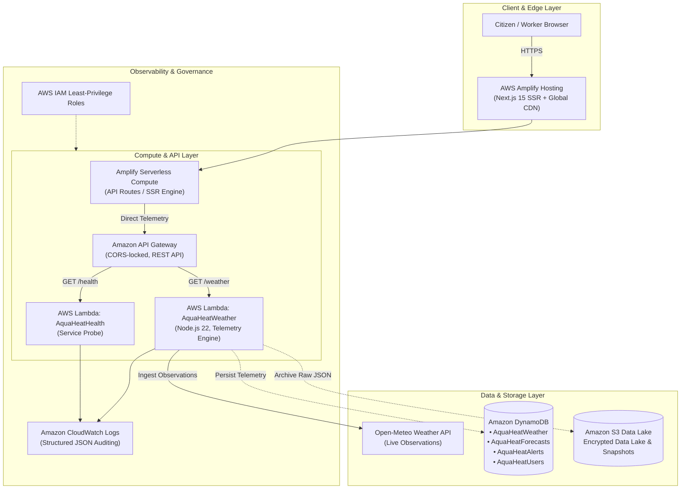

# AquaHeat — Mumbai Heat Safety & Environmental Risk Intelligence

[](https://main.d15bsc1go0apo2.amplifyapp.com)
[](https://aws.amazon.com/serverless/)
[](https://nextjs.org/)
[](https://www.typescriptlang.org/)
[](LICENSE)

> **Live Application URL:** **[https://main.d15bsc1go0apo2.amplifyapp.com](https://main.d15bsc1go0apo2.amplifyapp.com)**  
> Built for the AWS Hackathon — an end-to-end cloud platform providing real-time heat strain telemetry, personalized activity safety recommendations, and civic early warnings across Mumbai's urban microclimates.

---

## 📌 Problem Statement & Context

Mumbai experiences severe **wet-bulb temperature stress** — a hazardous combination of high ambient temperatures and oppressive maritime humidity. In dense urban pockets, the **Urban Heat Island (UHI)** effect elevates localized temperatures by 3°C to 6°C above coastal averages.

### The Real-World Impact
* **Vulnerable Workforces:** Delivery gig-workers, construction laborers, street vendors, and traffic personnel face dangerous heat exhaustion with zero advance micro-climate visibility.
* **Civic Blindspots:** City-wide aggregate weather reports obscure extreme neighborhood-level microclimates (e.g., comparing coastal Colaba to landlocked Kurla or Borivali).
* **Actionable Gap:** Citizens know it is "hot," but lack actionable, activity-specific guidelines (e.g., safe hydration intervals, shaded rest thresholds, and work-rest ratios).

> **Important Scope Note:** AquaHeat tracks and analyzes **environmental heat risk** and **activity exposure strain**. It provides preventive civic guidance and does not provide clinical medical diagnosis.

---

## 🏛️ System Architecture

AquaHeat is architected natively on AWS, adopting a hybrid serverless deployment strategy combining **AWS Amplify Hosting** for global edge delivery with **AWS Serverless Application Model (SAM)** for modular backend microservices.





---

## ☁️ How AWS Powers AquaHeat

| AWS Service | Architecture Role | Production Benefit |
|-------------|-------------------|-------------------|
| **AWS Amplify Hosting** | Full-Stack Edge Hosting | Hosts the responsive Next.js 15 UI and executes serverless API routes natively inside AWS with automated CI/CD and zero Vercel dependencies. |
| **AWS Lambda** | Microservice Compute | Node.js 22 execution runtime for real-time telemetry processing, health verification, and deterministic NOAA heat strain calculations. |
| **Amazon API Gateway** | Managed REST Interface | Enforces CORS origins (`main.d15bsc1go0apo2.amplifyapp.com`), request throttling, JSON validation, and CloudWatch execution logging. |
| **Amazon DynamoDB** | On-Demand NoSQL Database | Sub-millisecond partitioned persistence for live observations, multi-horizon forecasts, and civic alert dispatches with Point-in-Time Recovery (PITR). |
| **Amazon S3** | Encrypted Data Lake | Private S3 bucket (`SSE-AES256`) with strict public access blocks and automated lifecycle rules (Standard → Standard-IA → Glacier). |
| **AWS SAM (CloudFormation)** | Infrastructure as Code | Declarative infrastructure provisioning (`infra/template.yaml`) enabling automated, reproducible multi-tier AWS deployments. |
| **Amazon CloudWatch** | Structured Monitoring | 30-day retention log groups capturing latency, error rates, and invocation diagnostics across all API routes. |
| **AWS IAM** | Least-Privilege Security | Scoped IAM execution roles restricting microservice permissions to only explicitly required ARNs. |

---

## 🗺️ Mumbai Urban Microclimate Zones

AquaHeat monitors six representative urban zones reflecting distinct microclimates across the Mumbai Metropolitan Region:

| Zone ID | Zone Name | Representative Station | Microclimate Profile |
|:-------:|-----------|------------------------|---------------------|
| `south-mumbai` | **South Mumbai** | Colaba (`18.9067°N, 72.8147°E`) | Maritime coastal breeze; high continuous relative humidity. |
| `western-suburbs` | **Western Suburbs** | Andheri (`19.1136°N, 72.8697°E`) | Dense commercial/residential corridor; elevated vehicle heat. |
| `eastern-suburbs` | **Eastern Suburbs** | Ghatkopar (`19.0860°N, 72.9090°E`) | Inland heat accumulation with reduced sea-breeze penetration. |
| `central-mumbai` | **Central Mumbai** | Dadar (`19.0178°N, 72.8478°E`) | High-density urban core with significant thermal mass absorption. |
| `harbour` | **Harbour** | Chembur (`19.0522°N, 72.8994°E`) | Industrial/refinery zone with localized particulate and thermal variance. |
| `northern-mumbai` | **Northern Mumbai** | Borivali (`19.2307°N, 72.8567°E`) | Rapidly developing outer urban basin with intense daytime peak temperatures. |

---

## ⚡ Core Features

1. **Real-Time Environmental Telemetry:**
   * Live ambient temperature, apparent ("feels-like") temperature, relative humidity, precipitation, wind speed, and cloud cover.
2. **NOAA/NWS Heat Index Risk Classification:**
   * Deterministic categorization into **Low**, **Moderate**, **High**, **Very High**, or **Extreme** risk levels without fabricated synthetic fallbacks.
3. **Personalized Activity Strain Guidance:**
   * Tailored recommendations based on specific user profiles (Outdoor Delivery, Construction Work, Sports/Exercise, Commuting, Elderly/Sedentary).
4. **Hydration & Shaded Rest Timers:**
   * Calculated work-rest intervals (e.g., 45 min work / 15 min shade) and minimum fluid replenishment rates (liters/hour).
5. **Multi-Horizon Forecast Curves:**
   * Hourly projection timelines allowing shift workers and planners to anticipate peak heat windows before midday spikes.

---

## 📁 Repository Structure

```text
AquaHeat/
├── amplify.yml                     # AWS Amplify Hosting build and deploy specification
├── architecture-diagram.png        # System architecture diagram
├── app/
│   └── frontend/                   # Next.js 15 + TypeScript Frontend
│       ├── app/
│       │   ├── api/weather/        # Serverless API route (Amplify Lambda runtime)
│       │   ├── page.tsx            # Main interactive dashboard
│       │   └── layout.tsx          # Root theme & accessibility layout
│       ├── components/             # Modular UI components (Dashboard, Zones, Advisory)
│       └── lib/                    # Zone definitions and formatting utilities
├── backend/
│   ├── functions/
│   │   ├── health/                 # AWS Lambda health probe (GET /health)
│   │   └── weather/                # AWS Lambda weather telemetry (GET /weather)
│   └── shared/
│       ├── db/                     # DynamoDB client & repository access layer (SDK v3)
│       ├── models/                 # Strong TypeScript domain models
│       ├── services/               # Weather provider service & NOAA heat index logic
│       └── zones/                  # Authoritative Mumbai zone geo-coordinates
├── infra/
│   ├── template.yaml               # AWS SAM Infrastructure as Code (API GW, Lambdas, Tables, S3)
│   └── iam/
│       └── aquaheat-deployer-policy.json # Scoped least-privilege deployment policy
├── tests/
│   └── unit/                       # Vitest / Jest test suites
│       ├── dynamodb-dal.test.ts    # DynamoDB repository unit tests
│       ├── weather-service.test.ts # Weather service & NOAA calculation tests
│       ├── weather-model.test.ts   # Domain validation tests
│       └── zones.test.ts           # Geographic coordinate integrity tests
└── docs/                           # Hackathon documentation, blog post & video scripts
```

---

## 🚀 Local Development

### Prerequisites
* **Node.js** >= 20.x
* **npm** >= 10.x
* **AWS SAM CLI** (optional, for local infrastructure emulation)

### 1. Clone & Install Dependencies
```bash
git clone https://github.com/ruthweb-site/Aquaheat.git
cd Aquaheat
npm install
cd app/frontend && npm install && cd ../..
```

### 2. Run the Next.js Frontend
```bash
cd app/frontend
npm run dev
```
Open [http://localhost:3000](http://localhost:3000) to view the live dashboard.

### 3. Run Unit Tests
```bash
npm test
```
All unit test suites validate:
* Deterministic NOAA heat index thresholds
* Geographic zone coordinate boundaries
* DynamoDB payload formatting and schema adherence
* Clean error handling for external provider timeouts

---

## 📦 Infrastructure Deployment (AWS SAM)

To deploy the standalone backend microservices to your AWS account:

```bash
# Validate SAM template
sam validate -t infra/template.yaml

# Build serverless artifacts
sam build -t infra/template.yaml

# Deploy to AWS
sam deploy --guided --template-file .aws-sam/build/template.yaml
```

Outputs provisioned:
* `AquaHeatApi`: Regional REST API Gateway
* `AquaHeatWeatherFunction`: Telemetry processing Lambda
* `AquaHeatHealthFunction`: Health probe Lambda
* `AquaHeatWeatherTable`, `AquaHeatForecastsTable`, `AquaHeatAlertsTable`, `AquaHeatUsersTable`: On-Demand DynamoDB tables
* `AquaHeatDataBucket`: AES-256 encrypted private S3 bucket

---

## 📄 License

This project is licensed under the MIT License — see the [LICENSE](LICENSE) file for details.
