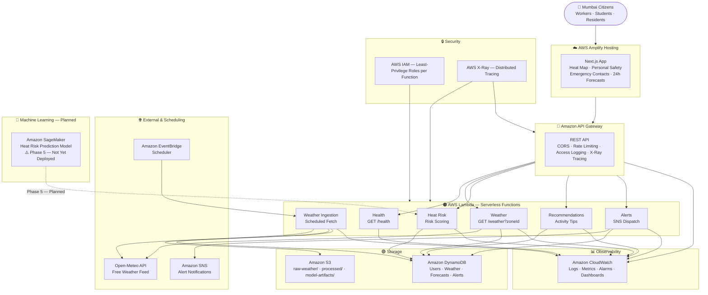

# AquaHeat — Building a Real-Time Heat Safety Platform for Mumbai on AWS

> *How we designed a serverless, data-driven heat risk platform for India's most heat-stressed city — and why every architectural decision was made with public safety, scalability, and security in mind.*

---

## The Problem: Mumbai's Silent Heat Crisis

Mumbai is no stranger to extreme weather. With a tropical climate, dense urban heat islands, and millions of outdoor workers — delivery partners, construction labourers, vegetable vendors, schoolchildren walking to bus stops — the city faces a heat safety crisis that is largely invisible until it is too late.

**The hard numbers:**
- India reported over **25,000 heat-related deaths** between 1992 and 2019, according to the National Disaster Management Authority.
- Mumbai's **Urban Heat Island (UHI) effect** means paved, densely built neighbourhoods like Ghatkopar and Dadar can be **3–5°C hotter** than nearby coastal areas like Colaba on the same afternoon.
- Most people — especially daily-wage outdoor workers — have **no access to real-time, location-aware heat risk information** in a form they can understand and act on immediately.

The problem is not that Mumbai does not get hot. The problem is that people do not know *how* hot it is in *their neighbourhood right now*, and what that means for *their specific activity*.

---

## What AquaHeat Solves

AquaHeat is a **Mumbai-first heat safety web platform** that answers three questions every resident should be able to ask:

1. **"How dangerous is the heat in my part of Mumbai right now?"**
2. **"How risky is my planned activity given today's conditions?"**
3. **"What should I do if I or someone near me is suffering from heat illness?"**

### What AquaHeat is NOT

This is important: AquaHeat is not a medical device, not a heatstroke predictor, and not a substitute for emergency services. It describes **environmental heat risk** and **personal exposure risk**. Every emergency guidance card in the application is **deterministic and rule-based** — reviewed for safety, never AI-generated — to ensure it is reliable and never hallucinates medical advice.

---

## The Six Mumbai Zones

Mumbai is not one climate. AquaHeat divides the city into **six representative zones**, each tied to a precise real-world weather measurement point:

| Zone | Representative Location | Why it matters |
|---|---|---|
| South Mumbai | Colaba | Coastal moderation; tourist and business district |
| Western Suburbs | Andheri | Dense residential; airport corridor |
| Eastern Suburbs | Ghatkopar | Inland and exposed; significantly hotter UHI effect |
| Central Mumbai | Dadar | Heavy foot traffic; major transit hub |
| Harbour | Chembur | Industrial belt; elevated heat from surface materials |
| Northern Mumbai | Borivali | Suburban; near Sanjay Gandhi National Park |

Each zone is fed by a live weather data fetch, producing real observations of temperature, apparent temperature (feels-like), relative humidity, wind speed, cloud cover, and precipitation. No data is ever fabricated or interpolated — if the upstream source is unavailable, the platform returns an error rather than a made-up number.

---

## The Architecture

AquaHeat runs entirely on AWS, deployed with **AWS SAM** (Serverless Application Model). The entire infrastructure stack is defined as code — every Lambda function, every database table, every log group, every IAM role — in a single versioned template that can reproduce the full production environment from scratch in minutes.

---

## AWS Service Breakdown — What Each Service Does

### AWS Amplify Hosting — The Frontend Layer

Amplify Hosting serves the Next.js frontend to users. Every time a new version of the code is pushed to the repository, Amplify automatically runs the build pipeline — installing dependencies, compiling the application, and deploying the result to a global CDN. Users across Mumbai get fast page loads because the static assets are cached close to them geographically.

Amplify also handles environment-specific configuration, so the development, staging, and production versions of the app each point to their own backend without any manual wiring. The choice to use Amplify over third-party hosting platforms like Vercel keeps the entire stack — DNS, CDN, compute, database, storage — within a single AWS account, which simplifies compliance, IAM boundaries, and audit trails.

---

### Amazon API Gateway — The Secure API Layer

API Gateway sits between the frontend and all backend logic. It is the single front door for every browser request. No Lambda function is ever directly reachable from the internet — everything goes through API Gateway first.

It handles several responsibilities that would otherwise need to be built individually inside each Lambda:

- **CORS enforcement** — only the configured production origin is permitted to call the API. Requests from any other domain are rejected before they reach the backend.
- **Rate limiting and throttling** — burst limits prevent a surge of traffic from overwhelming the serverless compute layer.
- **Structured access logging** — every request is written to CloudWatch with details including the caller IP, HTTP method, route, response status code, and response size, enabling security audits and traffic analysis.
- **Distributed tracing** — X-Ray traces are attached to every request at the API Gateway layer, so a single trace spans from the browser call all the way through to the Lambda and database, making performance bottlenecks easy to identify.

---

### AWS Lambda — Six Serverless Functions

All backend logic runs as Lambda functions — small, focused, independently deployable units of compute that run only when called and cost nothing when idle. Each function runs on Node.js 22.x and has its own dedicated IAM execution role scoped to only the permissions that specific function needs. No function can access another function's database table, log group, or S3 prefix.

#### Health Lambda
The simplest function in the stack. It responds to `GET /health` with a confirmation that the service is running. Its sole purpose is to act as a liveness probe for monitoring systems, uptime checks, and CI smoke tests after a deployment. Its IAM role is the most restricted in the entire stack — it can only write to its own CloudWatch log group, nothing else.

#### Weather Lambda
The most actively called function. When a user selects a Mumbai zone on the frontend, this function fetches live atmospheric data from Open-Meteo's free weather API for that zone's GPS coordinates. It pulls current temperature, apparent (feels-like) temperature, relative humidity, wind speed, cloud cover, and precipitation. It then validates every field — if any value is missing or non-numeric, the function returns an error rather than a fabricated reading.

The heat risk tier is derived from the apparent temperature using the NOAA / National Weather Service heat index scale:

| Apparent Temperature | Risk Level |
|---|---|
| Below 27°C | SAFE |
| 27°C – 32°C | LOW |
| 32°C – 41°C | MODERATE |
| 41°C – 54°C | HIGH |
| 54°C and above | EXTREME |

The function also fetches a 24-hour hourly forecast for each zone, so the frontend can show users how conditions are expected to change through the rest of the day. A built-in timeout prevents the function from hanging indefinitely if the weather data provider is slow.

#### Heat Risk Lambda
This function is responsible for composite risk scoring — combining environmental data with activity context. Currently it applies deterministic rule-based scoring using the same NOAA thresholds. When the Amazon SageMaker ML model is deployed in Phase 5, this function will call it without any changes to the API contract. The response structure already includes fields for `futureHeatRiskScore` and `modelConfidence`, which are returned as null until the model is online.

#### Recommendations Lambda
This function returns personalised safety guidance based on what the user tells the app they are doing. Six activity types are supported — walking, exercise, outdoor labour, commuting, school or college, and staying indoors. For each combination of activity type and current zone risk level, the function returns a specific hydration rate, pacing and rest-break frequency, and heat management tips. For example, a delivery partner on a HIGH-risk day gets a mandatory 10–15 minute rest schedule, salted lime water guidance, and a warning to avoid prolonged heavy exertion between 1 PM and 3:30 PM.

#### Alerts Lambda
When a zone crosses into HIGH or EXTREME risk, this function dispatches heat warnings via Amazon SNS. It writes a full record of every alert to the AquaHeatAlerts DynamoDB table, where it can be queried by location (to build a zone-level alert feed) or by user (to build a personal alert history). SNS decouples the alerting logic from delivery — the same function can notify users by SMS, email, or mobile push without any code changes.

#### Weather Ingestion Lambda
This function runs on a regular schedule driven by Amazon EventBridge. Rather than fetching weather data only when a user requests it, this function proactively collects fresh observations for all six Mumbai zones on a recurring basis and writes them into both DynamoDB and S3. This means the Weather Lambda always has warm, current data to serve instantly, even if the upstream Open-Meteo API experiences a brief slowdown. It also populates the S3 data lake that will feed the machine learning training pipeline.

---

### Amazon DynamoDB — Application Database

AquaHeat uses four DynamoDB tables, all configured with on-demand billing so there is no capacity planning required and costs scale with actual usage. All four tables have Point-In-Time Recovery enabled, providing a 35-day rollback window in case of accidental data corruption or deletion. Server-side encryption is enabled on all tables.

- **AquaHeatUsers** — stores citizen and worker profiles, used for personalised alert subscriptions and preference storage.
- **AquaHeatWeather** — stores time-series weather observations partitioned by zone ID. Each zone's full history of readings is accessible for trend analysis and charting.
- **AquaHeatForecasts** — stores multi-horizon forecast projections, structured to accept ML model outputs in Phase 5.
- **AquaHeatAlerts** — stores alert dispatch records with two Global Secondary Indexes: one for querying all alerts in a given zone, and one for querying all alerts for a specific user.

---

### Amazon S3 — Data Lake and Artifact Storage

The AquaHeat data bucket is strictly private — no public access of any kind is permitted, and an explicit bucket policy rejects any request that does not use an encrypted HTTPS connection. The bucket is versioned and uses AES-256 server-side encryption by default.

Three prefixes organise the data:

- **`raw-weather/`** — raw API responses from every Weather Ingestion run. These automatically transition to lower-cost Infrequent Access storage after 30 days, move to Glacier after 90 days, and are deleted after 365 days.
- **`processed/`** — cleaned and validated observation datasets formatted for ML training. These transition to Infrequent Access storage after 60 days.
- **`model-artifacts/`** — this prefix is reserved for the trained SageMaker model packages that will be generated in Phase 5. It is structured but not yet populated.

Lifecycle rules automatically handle storage cost optimisation without any manual intervention, and incomplete multipart uploads are aborted after seven days to prevent orphaned data from accumulating costs.

---

### Amazon EventBridge — Scheduled Data Collection

EventBridge acts as the heartbeat of the data pipeline. On a configurable cron schedule, it triggers the Weather Ingestion Lambda to fetch fresh observations for all six zones. This decouples proactive data collection from reactive user requests. If the Open-Meteo API is slow at the moment a user opens the app, the app still serves the most recently ingested observation rather than making the user wait for a live upstream fetch.

EventBridge also makes the schedule observable — missed or failed invocations are visible in CloudWatch, and dead-letter queues can be attached for retry logic.

---

### Amazon SNS — Alert Notifications

When a zone crosses a heat danger threshold, the Alerts Lambda publishes a message to an SNS topic. Any number of subscribers can receive that alert — an SMS to a registered user, an email to a municipal health administrator, or in a future phase, a push notification to a mobile app. Because delivery is handled by SNS, the alert logic in the Lambda never needs to change when a new notification channel is added.

---

### Amazon CloudWatch — Full-Stack Observability

Every Lambda function has a dedicated CloudWatch Log Group defined explicitly in the infrastructure template with a configured retention period between 7 and 365 days. This is a deliberate choice — if AWS auto-creates log groups, they have no retention policy by default, which leads to unbounded log storage costs and compliance gaps.

CloudWatch collects metrics across the full stack: Lambda error rates, invocation counts, execution duration, and concurrent execution counts; API Gateway 4xx and 5xx rates and integration latency; and DynamoDB consumed capacity and throttled requests. Custom metrics published on each Weather Lambda invocation make it possible to build dashboards showing the current heat risk level for each zone over time, visualising heatwave events as they develop.

---

### AWS IAM — Least-Privilege Security

Security in AquaHeat is not a layer added after the fact — it is baked into every resource definition. Each Lambda function has its own execution role that grants only the exact API actions it needs on only the exact AWS resource ARNs it owns. The Health Lambda can write logs. The Weather Lambda can write logs and read its DynamoDB table. The Alerts Lambda can write logs, write to the Alerts table, and publish to the SNS topic. Nothing more.

The deployer IAM user that runs `sam deploy` has a custom customer-managed policy — no AdministratorAccess, no wildcard actions. It can manage CloudFormation stacks matching the project's naming pattern, upload artifacts to the SAM deployment bucket, and create or update the specific Lambda functions, DynamoDB tables, S3 bucket, API Gateway, CloudWatch log groups, and IAM execution roles that the template defines. Every permission is scoped to an ARN pattern, and IAM role creation is conditioned on the role being passed only to the Lambda service — preventing privilege escalation.

---

## What's Planned — Amazon SageMaker (Phase 5)

The machine learning component is fully designed but not yet deployed. When Phase 5 begins, a Python-based supervised learning model will be trained on historical weather data stored in the S3 data lake — temperature, apparent temperature, humidity, wind speed, and zone-level observations collected over time. The trained model will be hosted as a SageMaker inference endpoint.

The Heat Risk Lambda will call this endpoint to return a `futureHeatRiskScore` (a 0–100 continuous risk score) and a `modelConfidence` value alongside the current deterministic NOAA tier. The API response structure already reserves these fields — they are returned as null until the model is live, so the frontend and all downstream integrations require no changes when Phase 5 deploys.

The reason ML matters here is that rule-based thresholds cannot capture the non-linear interaction between high humidity, low wind speed, dense urban surface materials, and sustained heat accumulation that creates dangerous conditions even at moderate air temperatures. A trained model can learn those patterns from real data.

---

## The Frontend — What Users See

The Next.js frontend, served via Amplify, presents three main panels:

**Zone Heat Map Panel** — Real-time risk level badges for all six Mumbai zones. Each zone card shows the current temperature, apparent temperature, relative humidity, wind speed, and a 24-hour forecast timeline so users can see not just how dangerous it is now, but when conditions are expected to peak or ease through the day.

**Personal Exposure Section** — Six large activity cards: Walking, Exercise, Outdoor Work, Travelling, School/College, and Staying Indoors. Selecting an activity instantly updates a personalised guidance panel showing the recommended hourly fluid intake, pacing and rest-break frequency, and specific heat management tips for that activity under today's conditions. This is the section built for delivery partners and construction workers who need actionable numbers, not general advice.

**Emergency Section** — A clinically differentiated guide to heat exhaustion (urgent care needed) and heat stroke (a medical emergency — call 108 immediately). Each card lists the specific symptoms to look for and the exact steps to take. Below the symptom guide is a grid of verified Mumbai emergency helplines — Maharashtra Ambulance (108), BMC Disaster Management (1916), Mumbai Police (100), and Fire Brigade (101) — all with one-tap dial links.

---

## What Makes AquaHeat Different

| Feature | AquaHeat | A Generic Weather App |
|---|---|---|
| Mumbai zone granularity | 6 zones with distinct urban heat profiles | Single city-wide reading |
| Activity-aware guidance | Calibrated by activity type and current risk | Not supported |
| Heat risk standard | NOAA/NWS heat index applied to apparent temperature | Raw air temperature |
| Emergency guidance | Curated, rule-based, clinically reviewed | Not present |
| Data integrity policy | No fabricated fallbacks, ever | Often interpolated or estimated |
| Infrastructure | Fully serverless, AWS-native, IaC-defined | Managed SaaS platforms |
| Security model | Per-function least-privilege IAM roles | Platform defaults |

---

## What's Next

AquaHeat is built incrementally in reviewed phases:

- **Phases 1–2 ✅** — Repository structure, zone definitions, shared data models
- **Phase 3 ✅** — SAM infrastructure foundation: API Gateway, Lambda, DynamoDB, S3, CloudWatch, IAM
- **Phase 4 ✅** — Live weather integration: Open-Meteo, Weather Lambda, Weather Ingestion, 24-hour forecasts, zone telemetry API
- **Phase 5 — In planning** — Amazon SageMaker ML heat risk model: training pipeline, inference endpoint, Heat Risk Lambda integration
- **Future** — IMD (India Meteorological Department) data integration; Amazon Cognito-authenticated user profiles; mobile push alerts via SNS; cities beyond Mumbai

---

## Building for Real Impact

AquaHeat is built for the people who need it most. The delivery partner doing ten runs in peak summer. The construction worker on exposed concrete. The school student walking home at 3 PM with no shade.

The architecture is deliberately serverless so it scales to zero at midnight and handles a surge during a city-wide heat alert without any manual intervention. Every design decision — from per-function IAM roles to Point-In-Time Recovery on every DynamoDB table, to the hard rule that fabricated weather data is never returned — is made with one principle in mind:

**When the heat index is 47°C and someone checks this app, it must be correct, available, and trustworthy.**

---

*Built with AWS SAM · Node.js 22.x · Next.js · Open-Meteo · ap-southeast-2*
